# zmk-config-totem-keycoon

ZMK firmware config for the [TOTEM](https://github.com/GEIGEIGEIST/TOTEM) split keyboard (38 keys, wireless, XIAO BLE). Home-row mods, five layers selected with the thumbs, combos for brackets and punctuation, ZMK Studio enabled.

## Keymap

  

The picture is generated from `config/totem.keymap` by [keymap-drawer](https://github.com/caksoylar/keymap-drawer) on every push (`.github/workflows/draw.yml`). Blue bubbles are combos. `⇧ ⌃ ⌥ ⌘` under a letter is what the key sends when held.

| Layer | How to activate |
|---|---|
| BASE | default |
| NUM | hold the right middle thumb |
| SYM | hold the left middle thumb |
| ADJUST | hold both middle thumbs; every key sends `Ctrl+Option+Cmd+key`, `H J K L` are arrows |
| FN | hold the right outer thumb: F-keys, media, Bluetooth profiles (Z / X / C = profile 0 / 1 / 2) |

## Timings

| Setting | Value |
|---|---|
| Home-row mods | `balanced` flavor, 280 ms tapping term, 175 ms quick-tap, 150 ms prior-idle |
| Combos | 45 ms window, 125 ms prior-idle |
| Language combo | 35 ms window, 150 ms prior-idle |

## Combos

BASE layer, press both keys at once:

| Combo | Output | | Combo | Output |
|---|---|---|---|---|
| `Q+W` | `` ` `` | | `R+T` | `[` |
| `W+E` | `_` | | `Y+U` | `]` |
| `E+R` | `-` | | `F+G` | `(` |
| `R+G` | `+` | | `H+J` | `)` |
| `U+H` | `=` | | `V+B` | `{` |
| `U+I` | `:` | | `N+M` | `}` |
| `I+O` | `;` | | `O+P` | `'` |

Thumb combos, all layers:

| Combo | Output |
|---|---|
| `Space+Bksp` | `Cmd+Space` (switch input language) |
| `Tab+SYM+Space` | `'` |
| `Bksp+NUM+FN` | `"` |

## Installation

1. Push your changes to GitHub. The **Build ZMK firmware** workflow starts automatically (*Actions* tab).
2. Open the finished run. After a successful build, download the **firmware** archive from the **Artifacts** block and unzip it.
3. Connect the main (left) half to the computer with a USB cable.
4. Double-tap the **reset** button quickly. A new drive named **XIAO-SENSE** appears.
5. Copy the `.uf2` file for the left half (`totem_left…`) from the unzipped folder onto that drive.
6. When the copy finishes, the drive disconnects by itself. The firmware is installed and the keyboard is ready to use.

The right half does not need to be flashed.
